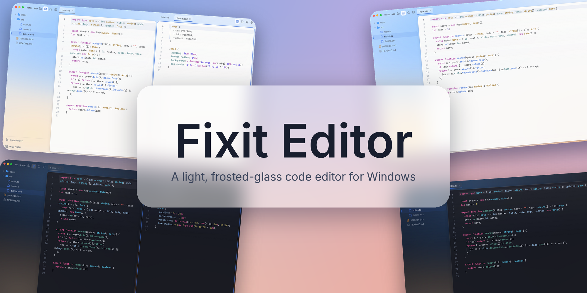
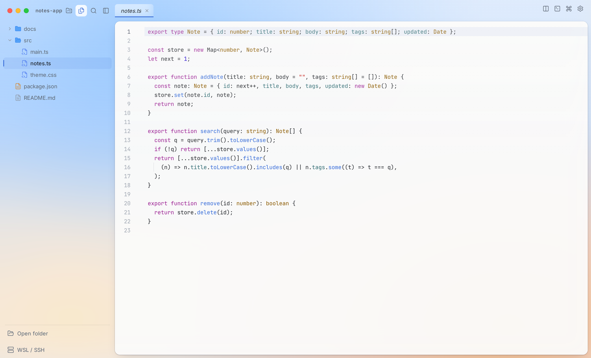
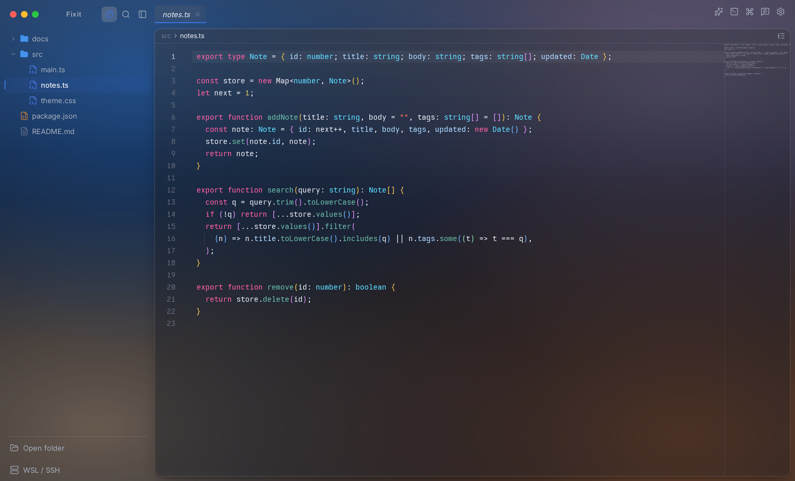
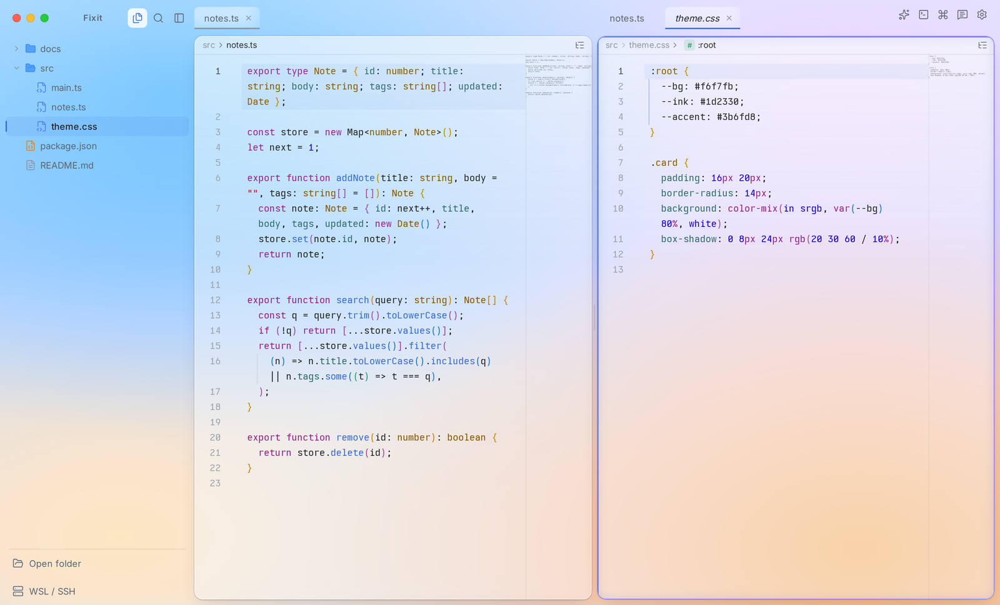
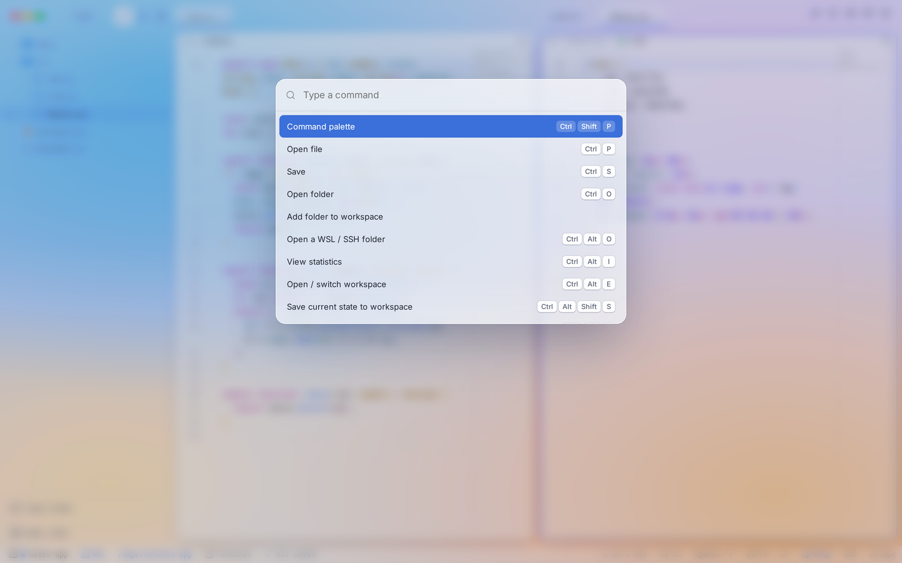

<div align="center">



# Fixit Editor

**Un editor de código ligero y elegante para Windows, con aspecto de cristal esmerilado.**


[Sitio web](https://fixit-editor.lapius7.com) · [Documentación](https://fixit-editor.lapius7.com/docs) · [Historial de cambios](https://fixit-editor.lapius7.com/changelog) · [Licencia](#licencia)

[English](README.md) · [日本語](README.ja.md) · [한국어](README.ko.md) · [简体中文](README.zh-CN.md) · **Español**

</div>

## Resumen

Fixit Editor es un pequeño editor de código con aspecto de cristal esmerilado. Funciona con un solo archivo, `Fixit-Editor.exe`, sin instalador. Está hecho con CodeMirror 6 y Tauri, así que arranca rápido y consume poco.

Los ajustes, las estadísticas y los espacios de trabajo se guardan en tu PC. Lo que programas no sale de ella, salvo cuando haces una pregunta a una IA, inicias sesión en Lapount con la sincronización activada, envías comentarios o se envía el recuento anónimo de uso.

<p align="center">
  
  
</p>

## Funciones

**Edición**

- Abre una o varias carpetas y edita con resaltado de sintaxis, autocompletado y búsqueda (CodeMirror 6).
- Vista dividida, búsqueda en todos los archivos, paleta de comandos y apertura rápida.
- Abre imágenes, PDF, Word, audio y vídeo. Markdown y HTML se previsualizan junto al código fuente.
- Varias terminales, con pestañas que se pueden renombrar.

**Remoto y espacios de trabajo**

- Abre carpetas de WSL y SSH como si fueran locales: explorar, editar, guardar, renombrar, eliminar, buscar y usar una terminal. Los archivos CRLF conservan sus saltos de línea.
- Los espacios de trabajo guardan carpetas, pestañas, división y terminales, y los restauran en el siguiente inicio.
- Los perfiles agrupan apariencia, ajustes y atajos. Puedes cambiar entre ellos, vincular uno a un espacio de trabajo o exportarlos e importarlos como archivos.

**Aspecto y sensaciones**

- Claro, oscuro o según el sistema. El fondo es una malla de colores que modelas arrastrando puntos.
- Más de 120 ajustes, con búsqueda, filtro de «solo los cambiados», restablecimiento individual y exportación e importación en JSON.
- Más de 70 atajos de teclado que puedes reasignar.
- Interfaz en japonés, inglés y coreano.

**IA, solo cuando preguntas**

- Pregunta sobre el código seleccionado o el archivo abierto. Usa tu propia clave de API de Anthropic u OpenAI, o inicia sesión con tu suscripción de Claude mediante el comando oficial `claude`.
- Antes del primer envío a cada proveedor aparece una pantalla de consentimiento.

<p align="center">
  
  
</p>

## Privacidad

Solo lo siguiente puede salir de tu PC. El contenido, los nombres y las rutas de los archivos nunca se incluyen.

- **Preguntas a la IA:** el código seleccionado, el archivo abierto y tu mensaje se envían al proveedor que elijas.
- **Recuento anónimo de uso:** una vez al día, un ID aleatorio, la versión de la app, el tipo de sistema operativo y el idioma. No hay ajuste para desactivarlo.
- **Comentarios:** solo cuando pulsas Enviar: tu mensaje, su tipo, un contacto opcional, la versión de la app, el sistema operativo y el idioma.
- **Inicio de sesión en Lapount (opcional):** solo si inicias sesión, la app obtiene el nombre y el icono de tu cuenta y sincroniza tus ajustes, perfiles y espacios de trabajo (nombres, colores y ubicaciones de carpetas). Las pestañas abiertas, los terminales, las claves y conversaciones de IA, las estadísticas y el contenido de los archivos no se sincronizan. Puedes desactivar la sincronización y borrar los datos de la nube. Los comentarios enviados con la sesión iniciada se vinculan a tu cuenta para que puedas recibir respuestas.
- **Uso detallado y errores:** el tiempo de trabajo diario, los caracteres escritos y los guardados, y el tipo, el mensaje y el orden de llamadas de los errores. No hay ajuste para desactivarlo.

## Compilar desde el código fuente

Necesitas pnpm y Rust con el destino `x86_64-pc-windows-gnu`. El exe de Windows se compila desde WSL o Linux:

```bash
pnpm install
bash scripts/build-win.sh   # genera dist-win/Fixit-Editor.exe
```

## Licencia

[MIT](LICENSE)
