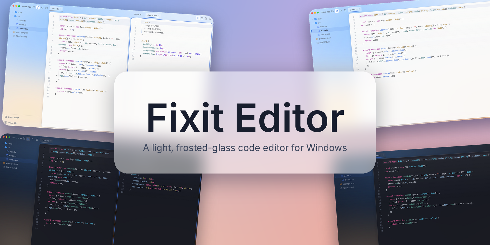
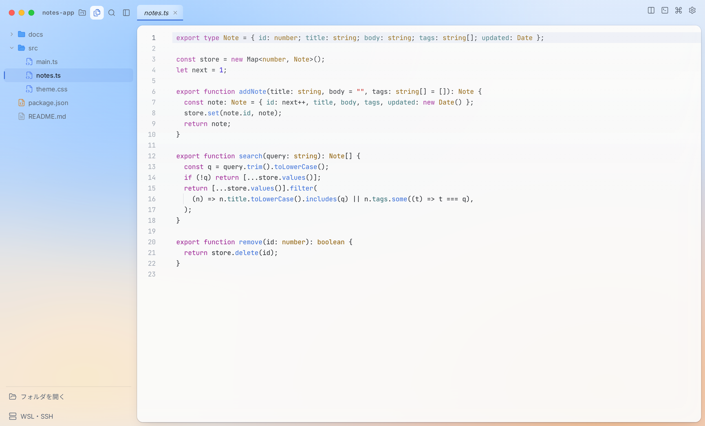
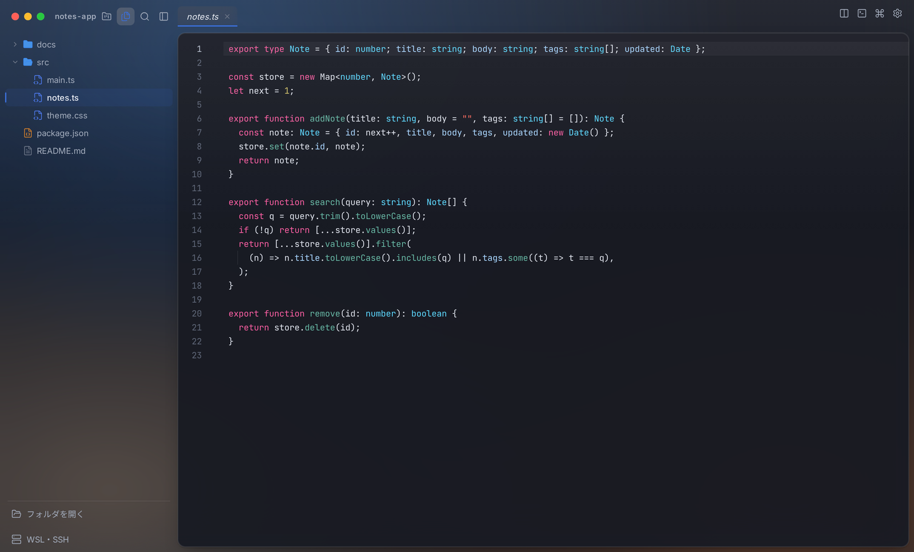
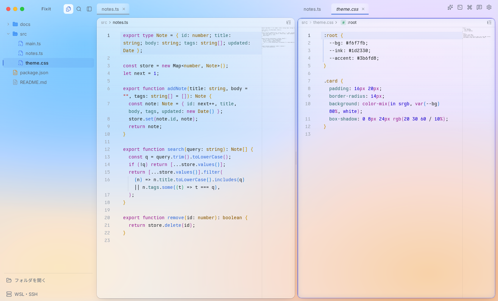
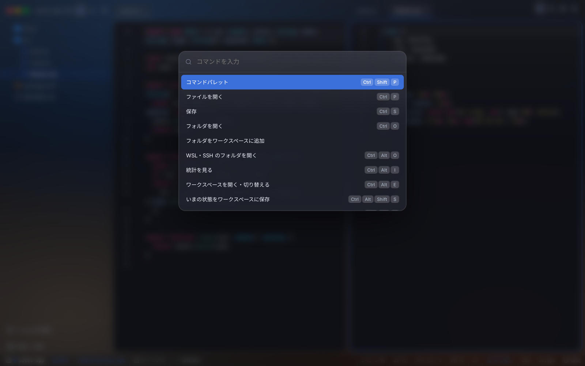

<div align="center">



# Fixit Editor

**軽くて見た目のいい、すりガラス調の Windows 用コードエディタ。**


[公式サイト](https://fixit-editor.lapius7.com) · [ドキュメント](https://fixit-editor.lapius7.com/docs) · [更新履歴](https://fixit-editor.lapius7.com/changelog) · [ライセンス](#ライセンス)

[English](README.md) · **日本語** · [한국어](README.ko.md) · [简体中文](README.zh-CN.md) · [Español](README.es.md)

</div>

## 概要

Fixit Editor は、すりガラス調の小さなコードエディタです。Windows 用に、インストーラー(`Fixit-Editor-Setup.exe`)と、単体の `Fixit-Editor.exe` の両方を用意しています。CodeMirror 6 と Tauri で作っているので、起動が速く軽く動きます。

設定・統計・ワークスペースは、この PC の中に保存します。AI に質問したとき、Lapount にログインして同期をオンにしたとき、匿名の利用数(常に送ります)、フィードバックを送ったとき、設定でオンにした匿名の送信を除いて、コーディングの内容は外へ送りません。

<p align="center">
  
  
</p>

## 機能

ここに書いた機能はすべて最新版の 1.0.8 で使えます。版ごとの変更は[更新履歴](https://fixit-editor.lapius7.com/changelog)にあります。

### 編集

- **言語と補完:** 多くの言語の色分けに対応し、補完では言語ごとの候補・開いている文書の単語・`for` や `if` などのスニペットが出ます。HTML と CSS では Emmet が使えます(略語を打って `Tab`)。HTML では `!` を打って `Enter` か `Tab` を押すと、HTML5 のひな形に展開します。
- **コードの見やすさ:** 表示範囲を枠で示すミニマップ、対応する括弧の色分け、インデントガイド、折りたたみ、対応する括弧の強調、括弧と引用符の自動補完があります。構文の誤りと JSON のエラーには波線が付きます。ミニマップ・色分け・波線は、それぞれオフにできます。
- **移動:** パンくず(ファイルの場所 › 今いる関数やクラス)をクリックすると同じ階層の一覧が開きます。アウトライン(`Ctrl+Shift+O`)ではシンボルを絞り込んで移動でき、行へ移動とクイックオープン(`Ctrl+P`)もあります。
- **検索と置換:** 一致数と、大文字小文字・単語単位・正規表現の切り替えがある、半透明の浮かぶパネルです。全文検索は、ファイルの絞り込み(`*.ts`、`src/**`)や除外ができ、開いているタブだけに絞ることもできます。
- **編集コマンド:** 複数カーソル、矩形選択、行の複製・移動・削除・並べ替え、コメントの切り替え、大文字小文字の変換、`Tab` と `Shift+Tab` でのインデントがあります。HTML と XML(JSX・TSX・Vue・PHP も)では、開始タグを書き換えると終了タグも一緒に変わります。
- **保存:** 自動保存、保存時の行末空白の削除と末尾の改行(どちらも任意)があります。さらに任意の設定で、行頭の空白をステータスバーのインデント幅と空白/タブの表示に合わせて書き換えます。Makefile、Markdown、複数行の文字列は対象外です。タブごとに元に戻す履歴とカーソル位置を保ちます。
- **ローカル履歴:** 保存のたびに、この PC へコピーを残します。今のファイルと比べて、好きな版へ戻せます(`Ctrl+Alt+H`)。
- **コードを画像に:** 選択範囲(なければファイル全体)を、グラデーション背景と macOS 風のウィンドウ付きの PNG にして、コピーまたは保存できます。色と背景は変えられます。
- **大きなファイル:** 1.9 MB を超えるファイルは、開けないとはせず、注意書きと「読み込む」ボタンを出します。エディタの外で変更されたファイルは、編集がなければ自動で読み直し、編集があるときは上書きしてよいか確かめます。

### 言語サーバー

初期状態ではオフです。設定でオンにすると、初めて使うときにサーバーを取得します(送るのはパッケージの取得リクエストだけで、コードやファイル名は送りません)。

- **対応言語:** TypeScript と JavaScript(TypeScript サーバー)、Python(Pyright)、HTML、CSS / SCSS / Less、PHP(Intelephense)、Go(gopls)、Rust(rust-analyzer)、Ruby(Solargraph)、MySQL(sqls)。
- **機能:** 補完(TypeScript は自動インポート付き)、ホバーでの型表示、定義へ移動(`F12`、`Ctrl+クリック`)、引数のヒント(`Ctrl+Shift+Space`)、参照の検索(`Shift+F12`)、ファイルをまたぐ名前の変更(`F2`)、コードアクション(`Ctrl+.`)、インレイヒント、`tsconfig.json` と `node_modules` に従うエラーの波線があります。開いていないファイルに及ぶ変更や、一部しか適用できない変更は、理由を示して断ります。
- **管理:** ステータスバーの項目(`TS`、`PY`、`RS` など)から、各サーバーの状態、サーバーごと・機能ごとのオンオフ、エラー時の再起動、動作中のサーバーの CPU とメモリを見られる一覧を開けます。サーバーは、対応するタブをすべて閉じてから一定時間(既定 1 分)たつか、アプリを終了すると止まります。WSL のフォルダでは、WSL のログインシェルの PATH を使います。

### ファイルとフォルダ

- **ファイルツリー:** 一覧の中で名前を打って、ファイルとフォルダを作れます(`test/01/main.js` と打つとフォルダも作ります)。名前の変更ではアイコンが拡張子に合わせて変わり、削除と、`Ctrl` や `Shift` での複数選択もできます。`Ctrl+X`・`Ctrl+C`・`Ctrl+V` での切り取り・コピー・貼り付けは、Windows のエクスプローラーでコピーしたファイルや、クリップボードの画像にも使えます。ドラッグで移動でき、閉じたフォルダの上で止まると開きます。エディタの外での変更は数秒で反映され、並び順はエクスプローラーと同じです。
- **複数のフォルダ:** ワークスペースにフォルダをいくつでも足せます。この PC のほか、WSL と SSH のフォルダも対象です。フォルダごとに見出しが付き、ワークスペースから外せて、中身まで開く/閉じるを一括でできます(`.git` と `node_modules` は閉じたままです)。
- **右クリックメニュー:** 外部のターミナルやエクスプローラーで開く、ここでターミナルを開く(PowerShell・コマンドプロンプト・Git Bash・WSL のディストリビューションから選択)、Git パネルで開く、パスのコピー、プレビューがあります。
- **ビューア:** 画像、PDF、音声、動画、Word(`.docx`)を、エディタの中で開きます。開けないファイルには、理由と対処を表示します。
- **画像エディタ:** 縦横比つきの切り抜き、回転、反転、リサイズ、明るさ・コントラスト・彩度・ぼかし・白黒・反転、元に戻す/やり直しができます。`Ctrl+ホイール` か数値の入力で拡大縮小でき、画像は PNG としてクリップボードへコピーできます。
- **コマンドライン:** インストーラーで入れると、ターミナルやエクスプローラーのアドレス欄で `fixit ./` と打って、フォルダを開けます。

### プレビューとブラウザ

- **Markdown と HTML のプレビュー**(`Ctrl+Alt+V`)は、ソースの横にも単独でも出せ、固定もできます。Markdown では Mermaid の図と LaTeX の数式(`$…$`、`$$…$$`、`` ```math ``)を描画します。Mermaid のファイル(`.mmd`、`.mermaid`)は、色分けとプレビューに対応しています。
- **HTML のプレビュー**は、相対パスの CSS・JavaScript・画像を表示し、保存前の CSS と JavaScript の変更も入力に合わせて反映します。エディタから切り離した表示で動きます。
- **内蔵ブラウザ**(`Ctrl+Alt+B`)で、Web ページをエディタの中で開きます。埋め込みを禁止しているサイトは表示できません。

### ターミナルと実行

- エディタの下に複数のターミナルを開けます。タブの名前は変えられ、この PC・WSL・SSH に対応します。URL はクリックでき、`Ctrl+V` で貼り付けられます。色はライト/ダークのテーマに従います。
- 開いているファイルは ▶(`Ctrl+Alt+R`)で実行します。拡張子ごとのコマンドは設定で変えられます。
- WSL のターミナルには `FIXIT_CWD=1` が渡されます。ホームへ移動する `.zshrc` でも、開いたフォルダのままにできます。

### Git

右側の Git パネル(ブランチのボタン、またはステータスバーのブランチ名から開きます)に 4 つのタブがあり、WSL と SSH のフォルダでも使えます。

- **変更:** ステージ、ステージ解除、コミット、変更の破棄(確認のため 2 回押します)、差分の表示。
- **ツリーと履歴:** コミットの分岐を線で描き、コミットごとの変更ファイルと差分を見られます。
- **ブランチ:** 作成、切り替え、削除(マージ済みのみ)、フェッチ、プル(早送りのみ)、プッシュ。
- **リポジトリでないフォルダ:** 新しく作るか、URL からクローンできます。開いたフォルダの中にあるリポジトリは、一覧から開けます。
- ファイルツリーには変更のあるファイルに印が付き、エディタの左端には追加・変更・削除された行が出て、ステータスバーにはブランチと変更数が出ます。

### リモートのフォルダとワークスペース

- WSL と SSH のフォルダを、この PC のフォルダと同じように開けます。閲覧・編集・保存・名前の変更・削除・検索・移動・Git パネル・ターミナルに対応し、CRLF のファイルは改行コードを保ちます。ピッカーでは、エクスプローラーのようにフォルダをたどり、新しいフォルダを作り、マウスの戻る/進むボタンで移動し、最近の場所を開き直せます。
- WSL のファイル操作と Git の読み取りは、WSL の中に残しておく作業用シェルを通します。操作のたびに `wsl.exe` を起動しません。残しておく時間は設定で変えられます(既定 5 分、0 で無効)。
- **ワークスペース**は、フォルダ・タブ・分割の配置・ターミナル・プレビューの状態・カーソル位置を保存し、次の起動で復元します。開始画面には、最近のワークスペースがフォルダ型のカードで並びます。
- **プロファイル**は、外観・設定・ショートカットをひとまとめにします。切り替えたり、ワークスペースに結び付けたり、ファイルとして書き出して読み込んだりできます。
- ウィンドウを複数開いても、設定・会話・ワークスペースは互いに上書きされません。

### タブとレイアウト

- タブは並べ替え、左への固定(`Alt+P`)、まとめて閉じる操作ができます。未保存のタブを閉じるときは、「保存して閉じる」を選べます。
- タブやファイルを端へドラッグするか「分割して開く」で、左右上下に何度でも分割できます。仕切りをドラッグして大きさを変え(ダブルクリックで半分ずつ)、ペインの入れ替えと向きの変更もできます。サイドバー・エディタ・AI・ブラウザの間の仕切りも動かせます。

### AI(質問したときだけ)

- **プロバイダー:** 自分の Anthropic / OpenAI の API キー、公式の `claude` コマンド経由の Claude サブスクリプション(Windows か WSL を選べます)、GitHub のデバイスログインで使う GitHub Copilot(無料プランでも使えます)、Google Gemini、Ollama・LM Studio・OpenRouter などの OpenAI 互換エンドポイントに対応します。どれも初期状態ではオフで、初めて送る前に、送信先を示す同意画面が出ます。
- **チャット:** `Ctrl+Alt+A` で開きます。モデルと思考の強さ(low〜max)を選べます。コードは「AI チャットに引用」(`Ctrl+Alt+Q`)で渡すほか、ファイルやタブをドラッグして添付できます(最大 8 件)。画像は最大 4 枚まで添付できます(PNG・JPEG・GIF・WebP。ほかの形式は変換し、大きいものは縮小します)。
- **会話:** 日ごとに分けた履歴、メッセージごとの時刻、履歴に残る添付画像、再生成、最新へ戻るボタンがあります。コードブロックはエディタと同じ色分けでコピーボタン付き、Mermaid と数式も描画します。リンクは既定のブラウザで開きます。
- **アクション:** エディタの右クリックメニューから、要約・説明・翻訳(日本語・英語・韓国語)・問題点の指摘・コメントの追加ができます。Git パネルのボタンでは、ステージした変更から、直近のコミットの言語と書き方に合わせたコミットメッセージを書きます。
- **ファイル:** AI は、開いているフォルダの中のファイルを一覧・読み取り・変更できます。読み取りは自動です。変更は差分のカードで示され、先に承認するか、「ファイルの変更を自動で適用する」をオンにします(初期状態はオフ)。フォルダの外、`.git`、`.env` や鍵のような秘密に見えるファイルには触れません。Claude サブスクリプション経由では使えません。
- **使用量:** Claude サブスクリプションの 5 時間と週の使用量、Copilot の枠を 5 分ごとに更新して表示し、API キーではトークン数を表示します。数字は、このエディタから送った分だけです。
- AI の回答中は、ウィンドウの縁に色の光が流れます(設定でオフにできます)。

### 見た目

- すりガラス調のデザインで、ライト・ダーク・OS に合わせるのいずれかを選べます。アクセントカラーと、背景の色のメッシュ(点をドラッグして形を作ります)は、プレビューを見ながら調整でき、面の不透明度、ウィンドウの余白、線の強さ、壁紙の粒子も変えられます。
- フォントは、画面・ファイルツリー・コードで別々に選べ、この PC のすべてのフォントを使えます。コードの既定のフォントは、同梱の Obel Mono です。
- アニメーション(ワークスペースの切り替えの波、分割のガラス、通知)は、ゆっくり・短く・オフにでき、OS の「視覚効果を減らす」設定にも従います。
- 表示言語は、日本語・English・한국어です。初回の画面で、言語・テーマ・アクセントカラー・基本の設定を選び、そのあと Lapount へのログインを案内します(省略できます)。

### 設定とショートカット

- 120 を超える設定を、検索、「変更したものだけ」の絞り込み、変更した項目の印、項目ごとのリセット、元に戻せる変更履歴、JSON の書き出しと読み込みで扱えます。
- 70 を超えるショートカットを自由に割り当てられ、キー名で検索できます。コマンドパレット(`Ctrl+Shift+P`)から、すべての操作を実行できます。
- 設定・AI の会話・統計は、`%APPDATA%\Fixit`(アプリ版)か localStorage(ブラウザ版)の JSON ファイルで、バックアップしやすい形です。
- 設定の「開発者向け情報」から、デバッグログをダウンロードできます(エラー、主な出来事、設定、環境。ユーザー名とフォルダ名は伏せます)。自動では送りません。

### 統計・更新・アカウント

- **統計:** コーディング時間、入力した文字数、キー入力数、保存回数、連続日数。
- **更新:** 「更新あり」の印が出て、「更新して再起動」で、署名とハッシュを確かめてからアプリを入れ替えます。設定やメニューから手動でも確認でき、確認に失敗したときは自動で再試行します。
- **フィードバック:** メニューから、不具合や要望を送れます。ログイン中は、開発者からの返信をアプリの中で読み、返信できます。
- **Lapount アカウント(任意):** ブラウザでコードを承認してログインします(エディタにパスワードは入力しません)。設定・プロファイル・ワークスペースを PC 間で同期でき、合計と返信は Web のダッシュボードで見られます。ログインしなくても、すべての機能が使えます。

### 安全面

- AI の API キーと Lapount のログイン情報は、Windows の機能で暗号化して保存します(exe 版のみ)。
- アプリが読み込めるものを制限し、HTML のプレビューはエディタから切り離しています。
- AI が触れるのは、開いているフォルダだけです。秘密に見えるファイルには触れません。

<p align="center">
  
  
</p>

## プライバシー

外へ送るのは次のものだけです。ファイルの中身・名前・パスは、AI への質問で説明するもの以外は含めません。

- **AI への質問:** 選択範囲・開いているファイル・入力した文章・AI が読んだファイルを、選んだプロバイダーへ送ります。
- **匿名の利用数:** 1 日 1 回、ランダムな ID・アプリの版・OS の種類・言語を送ります。オフにする設定はありません。
- **フィードバック:** 「送る」を押したときだけ、書いた内容・種類・任意の連絡先・アプリの版・OS・言語を送ります。
- **Lapount ログイン(任意):** ログインしたときだけ、アカウントの名前・アイコンを取得し、設定・プロファイル・ワークスペース(名前・色・フォルダの場所)を同期します。開いているタブ・ターミナル・AI のキーと会話・統計・ファイルの中身は同期しません。同期は設定でオフにでき、クラウドのデータも消せます。ログイン中に送ったフィードバックは、アカウントに紐づいて返信を受け取れます。
- **詳しい利用状況・エラー:** 1 日ごとの作業時間・入力数・保存回数と、エラーの種類・メッセージ・呼び出し順を送ります。設定項目はありません。
- **言語サーバー(オンにしたときだけ):** サーバー本体を npm、GitHub のリリース、`go install`、`gem install` から取得します。送るのはパッケージの取得リクエストだけです。
- **更新の確認:** 最新版の情報を取得します。

## ソースからビルド

pnpm と、`x86_64-pc-windows-gnu` ターゲットを入れた Rust が必要です。Windows 用の exe は WSL か Linux でビルドします。

```bash
pnpm install
bash scripts/build-win.sh   # dist-win/Fixit-Editor.exe ができます
```

## ライセンス

All rights reserved。アプリの利用は無料ですが、コードの複製・再配布・流用は禁止です。詳しくは [LICENSE](LICENSE) を参照してください。
