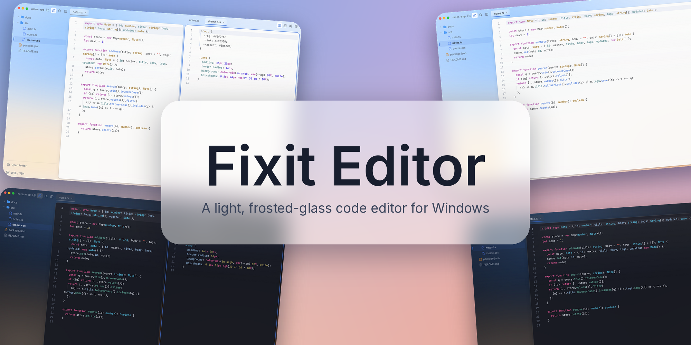
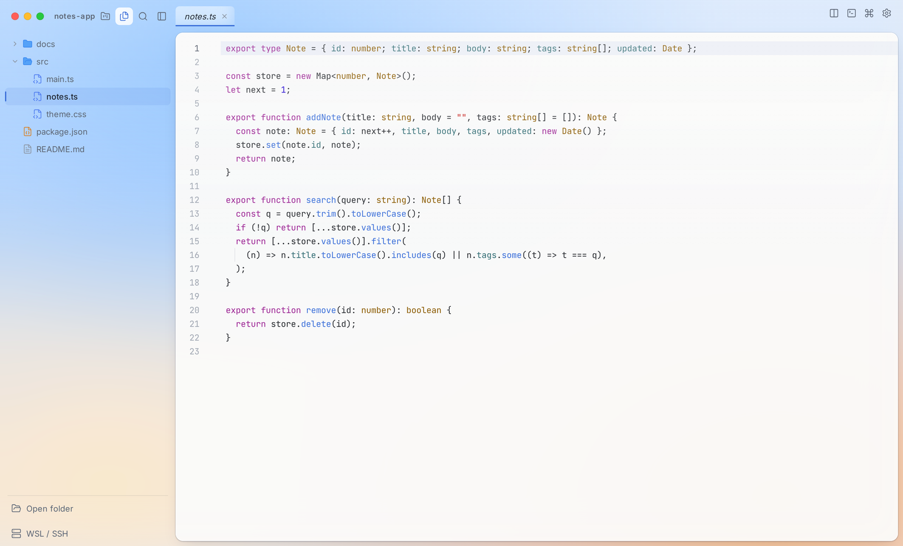
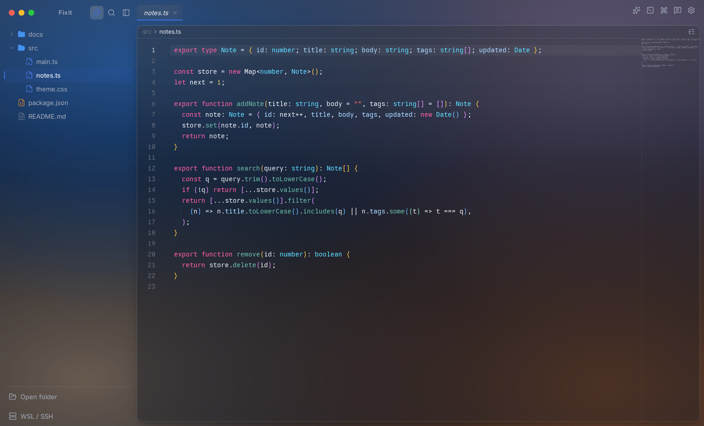
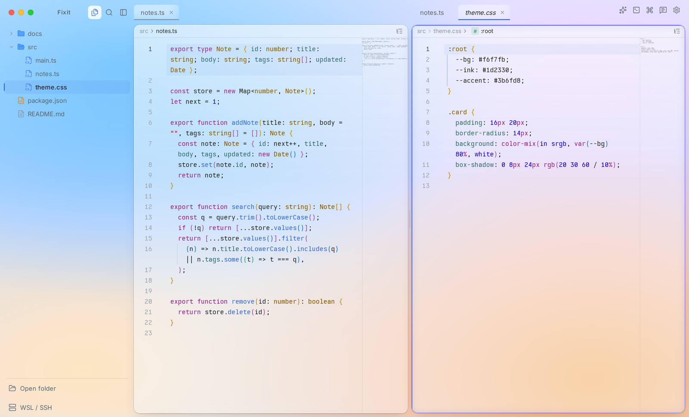
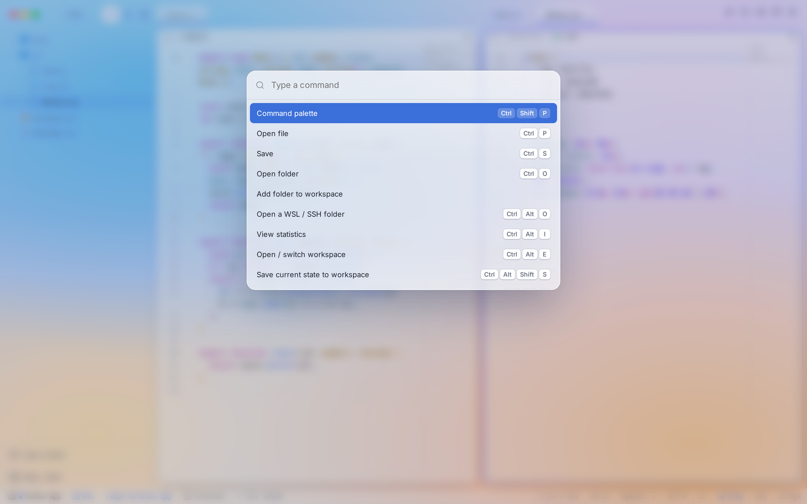

<div align="center">



# Fixit Editor

**가볍고 보기 좋은, 반투명 유리 느낌의 Windows용 코드 에디터.**


[웹사이트](https://fixit-editor.lapius7.com) · [문서](https://fixit-editor.lapius7.com/docs) · [변경 내역](https://fixit-editor.lapius7.com/changelog) · [라이선스](#라이선스)

[English](README.md) · [日本語](README.ja.md) · **한국어** · [简体中文](README.zh-CN.md) · [Español](README.es.md)

</div>

## 개요

Fixit Editor는 반투명 유리 느낌의 작은 코드 에디터입니다. Windows용으로 설치 프로그램(`Fixit-Editor-Setup.exe`)과 단독 실행 파일 `Fixit-Editor.exe`를 모두 제공합니다. CodeMirror 6와 Tauri로 만들어 빠르게 시작하고 가볍게 동작합니다.

설정, 통계, 워크스페이스는 이 PC에 저장됩니다. AI에 질문하거나, Lapount에 로그인해 동기화를 켜거나, 피드백을 보내거나, 익명 사용 횟수(항상 전송)와 설정에서 켠 익명 전송을 제외하면, 코딩 내용은 밖으로 나가지 않습니다.

<p align="center">
  
  
</p>

## 기능

여기에 적은 기능은 모두 최신 버전인 1.0.8에서 사용할 수 있습니다. 버전별 변경 사항은 [변경 내역](https://fixit-editor.lapius7.com/changelog)에서 볼 수 있습니다.

### 편집

- **언어와 자동 완성:** 여러 언어의 구문 강조를 지원하며, 자동 완성에는 언어별 후보, 열려 있는 문서의 단어, `for`·`if` 같은 스니펫이 나옵니다. HTML과 CSS에서는 Emmet을 쓸 수 있습니다(약어를 입력하고 `Tab`). HTML에서 `!`를 입력하고 `Enter` 또는 `Tab`을 누르면 HTML5 템플릿으로 펼쳐집니다.
- **코드 보기:** 보이는 범위를 틀로 표시하는 미니맵, 괄호 쌍 색상, 들여쓰기 가이드, 접기, 짝이 맞는 괄호 강조, 괄호와 따옴표 자동 완성이 있습니다. 구문 오류와 JSON 오류에는 물결 밑줄이 붙습니다. 미니맵, 색상, 물결 밑줄은 각각 끌 수 있습니다.
- **이동:** 이동 경로(파일 위치 › 현재 함수나 클래스)를 누르면 같은 단계의 목록이 열립니다. 개요(`Ctrl+Shift+O`)에서 심볼을 걸러 이동할 수 있고, 줄로 이동과 빠른 열기(`Ctrl+P`)도 있습니다.
- **찾기와 바꾸기:** 일치 개수와 대소문자·단어 단위·정규식 전환이 있는 반투명 떠 있는 패널입니다. 전체 검색은 파일 포함/제외(`*.ts`, `src/**`)를 지정하거나 열려 있는 탭만 검색할 수 있습니다.
- **편집 명령:** 다중 커서, 사각형 선택, 줄 복제·이동·삭제·정렬, 주석 전환, 대소문자 변환, `Tab`과 `Shift+Tab` 들여쓰기가 있습니다. HTML과 XML(JSX, TSX, Vue, PHP 포함)에서는 여는 태그 이름을 바꾸면 닫는 태그도 함께 바뀝니다.
- **저장:** 자동 저장, 저장 시 줄 끝 공백 제거와 마지막 줄바꿈(모두 선택 사항)이 있습니다. 선택 설정을 켜면 줄 앞의 공백을 상태 표시줄에 표시된 들여쓰기 너비와 공백/탭에 맞춰 다시 씁니다. Makefile, Markdown, 여러 줄 문자열은 제외됩니다. 탭마다 실행 취소 기록과 커서 위치를 유지합니다.
- **로컬 기록:** 저장할 때마다 이 PC에 사본을 남깁니다. 현재 파일과 비교하고 원하는 버전으로 되돌릴 수 있습니다(`Ctrl+Alt+H`).
- **코드를 이미지로:** 선택 영역(없으면 파일 전체)을 그라데이션 배경과 macOS 스타일 창이 있는 PNG로 만들어 복사하거나 저장합니다. 색상과 배경은 바꿀 수 있습니다.
- **큰 파일:** 1.9 MB가 넘는 파일은 열기를 거부하지 않고 안내와 「불러오기」 버튼을 표시합니다. 편집기 밖에서 바뀐 파일은 편집한 내용이 없으면 다시 읽고, 있으면 덮어쓸지 먼저 묻습니다.

### 언어 서버

기본값은 꺼짐입니다. 설정에서 켜면 처음 사용할 때 서버를 받아 옵니다(보내는 것은 패키지 요청뿐이며 코드와 파일 이름은 보내지 않습니다).

- **지원 언어:** TypeScript와 JavaScript(TypeScript 서버), Python(Pyright), HTML, CSS / SCSS / Less, PHP(Intelephense), Go(gopls), Rust(rust-analyzer), Ruby(Solargraph), MySQL(sqls).
- **기능:** 자동 완성(TypeScript는 자동 import 포함), 마우스를 올려 타입 보기, 정의로 이동(`F12`, `Ctrl+클릭`), 시그니처 도움말(`Ctrl+Shift+Space`), 참조 찾기(`Shift+F12`), 여러 파일에 걸친 이름 바꾸기(`F2`), 코드 작업(`Ctrl+.`), 인레이 힌트, `tsconfig.json`과 `node_modules`를 따르는 오류 물결 밑줄이 있습니다. 열지 않은 파일에 영향을 주거나 일부만 적용되는 변경은 이유를 알리고 거부합니다.
- **관리:** 상태 표시줄 항목(`TS`, `PY`, `RS` 등)에서 서버별 상태, 서버별·기능별 켜기/끄기, 오류 시 재시작, 실행 중인 서버의 CPU와 메모리를 볼 수 있는 목록이 열립니다. 서버는 해당 탭을 모두 닫고 일정 시간(기본 1분)이 지나거나 앱을 종료하면 멈춥니다. WSL 폴더에서는 WSL 로그인 셸의 PATH를 사용합니다.

### 파일과 폴더

- **파일 트리:** 목록 안에서 이름을 입력해 파일과 폴더를 만들 수 있습니다(`test/01/main.js`를 입력하면 폴더도 만듭니다). 이름을 바꾸면 아이콘이 확장자에 맞게 바뀌고, 삭제와 `Ctrl`·`Shift` 다중 선택도 됩니다. `Ctrl+X`, `Ctrl+C`, `Ctrl+V`의 잘라내기·복사·붙여넣기는 Windows 탐색기에서 복사한 파일과 클립보드 이미지에도 쓸 수 있습니다. 끌어서 이동할 수 있고, 닫힌 폴더 위에 멈추면 열립니다. 편집기 밖의 변경은 몇 초 안에 반영되며 정렬 순서는 탐색기와 같습니다.
- **여러 폴더:** 작업 공간에 폴더를 여러 개 추가할 수 있습니다. 이 PC뿐 아니라 WSL과 SSH 폴더도 됩니다. 폴더마다 제목이 붙고, 작업 공간에서 뺄 수 있으며, 하위까지 모두 펼치거나 접을 수 있습니다(`.git`과 `node_modules`는 닫힌 채로 둡니다).
- **오른쪽 클릭 메뉴:** 외부 터미널이나 탐색기에서 열기, 여기서 터미널 열기(PowerShell, 명령 프롬프트, Git Bash, WSL 배포판 중 선택), Git 패널에서 열기, 경로 복사, 미리보기가 있습니다.
- **뷰어:** 이미지, PDF, 오디오, 동영상, Word(`.docx`)를 편집기 안에서 엽니다. 열 수 없는 파일은 이유와 대처 방법을 보여 줍니다.
- **이미지 편집기:** 비율 지정 자르기, 회전, 뒤집기, 크기 조정, 밝기·대비·채도·흐림·흑백·반전, 실행 취소와 다시 실행이 있습니다. `Ctrl+휠` 또는 값 입력으로 확대/축소하며, 이미지는 PNG로 클립보드에 복사할 수 있습니다.
- **명령줄:** 설치 프로그램으로 설치하면 터미널이나 탐색기 주소창에 `fixit ./`를 입력해 폴더를 열 수 있습니다.

### 미리보기와 브라우저

- **Markdown과 HTML 미리보기**(`Ctrl+Alt+V`)는 소스 옆이나 단독으로 열 수 있고 고정도 됩니다. Markdown은 Mermaid 다이어그램과 LaTeX 수식(`$…$`, `$$…$$`, `` ```math ``)을 렌더링합니다. Mermaid 파일(`.mmd`, `.mermaid`)은 구문 강조와 미리보기를 지원합니다.
- **HTML 미리보기**는 상대 경로의 CSS, JavaScript, 이미지를 표시하고, 저장하지 않은 CSS와 JavaScript 변경도 입력에 맞춰 반영합니다. 편집기와 분리된 화면에서 실행됩니다.
- **내장 브라우저**(`Ctrl+Alt+B`)로 웹 페이지를 편집기 안에서 엽니다. 삽입을 금지한 사이트는 표시할 수 없습니다.

### 터미널과 실행

- 편집기 아래에 터미널을 여러 개 열 수 있습니다. 탭 이름을 바꿀 수 있고 로컬, WSL, SSH를 지원합니다. URL은 클릭할 수 있고 `Ctrl+V`로 붙여넣을 수 있습니다. 색상은 라이트/다크 테마를 따릅니다.
- 열려 있는 파일은 ▶(`Ctrl+Alt+R`)로 실행합니다. 확장자별 명령은 설정에서 바꿀 수 있습니다.
- WSL 터미널에는 `FIXIT_CWD=1`이 전달됩니다. 홈으로 이동하는 `.zshrc`가 있어도 연 폴더를 유지할 수 있습니다.

### Git

오른쪽 Git 패널(브랜치 버튼 또는 상태 표시줄의 브랜치 이름으로 엽니다)에 탭이 4개 있으며 WSL과 SSH 폴더에서도 동작합니다.

- **변경:** 스테이지, 스테이지 해제, 커밋, 변경 취소(확인을 위해 두 번 누름), 차이 보기.
- **트리와 기록:** 커밋 분기를 선으로 그리고, 커밋별 변경 파일과 차이를 볼 수 있습니다.
- **브랜치:** 만들기, 전환, 삭제(병합된 것만), fetch, pull(fast-forward만), push.
- **저장소가 아닌 폴더:** 새로 만들거나 URL에서 클론할 수 있습니다. 연 폴더 안의 저장소는 목록에서 열 수 있습니다.
- 파일 트리에는 변경된 파일에 표시가 붙고, 편집기 왼쪽 여백에는 추가·변경·삭제된 줄이 나타나며, 상태 표시줄에는 브랜치와 변경 수가 표시됩니다.

### 원격 폴더와 작업 공간

- WSL과 SSH 폴더를 이 PC의 폴더처럼 열 수 있습니다. 탐색, 편집, 저장, 이름 바꾸기, 삭제, 검색, 이동, Git 패널, 터미널을 지원하며 CRLF 파일은 줄바꿈을 유지합니다. 선택기에서는 탐색기처럼 폴더를 따라가고, 새 폴더를 만들고, 마우스 뒤로/앞으로 버튼으로 이동하고, 최근 위치를 다시 열 수 있습니다.
- WSL의 파일 작업과 Git 읽기는 WSL 안에 계속 떠 있는 작업용 셸을 거칩니다. 작업마다 `wsl.exe`를 실행하지 않습니다. 유지 시간은 설정에서 바꿀 수 있습니다(기본 5분, 0이면 사용 안 함).
- **작업 공간**은 폴더, 탭, 분할 배치, 터미널, 미리보기 상태, 커서 위치를 저장하고 다음 실행 때 복원합니다. 시작 화면에는 최근 작업 공간이 폴더 모양 카드로 나열됩니다.
- **프로필**은 외모, 설정, 단축키를 하나로 묶습니다. 전환하거나, 작업 공간에 연결하거나, 파일로 내보내고 가져올 수 있습니다.
- 창을 여러 개 열어도 설정, 대화, 작업 공간이 서로 덮어쓰이지 않습니다.

### 탭과 레이아웃

- 탭은 순서 변경, 왼쪽 고정(`Alt+P`), 한꺼번에 닫기를 지원합니다. 저장하지 않은 탭을 닫을 때 「저장하고 닫기」를 고를 수 있습니다.
- 탭이나 파일을 가장자리로 끌거나 「분할하여 열기」로 좌우상하로 몇 번이든 분할할 수 있습니다. 구분선을 끌어 크기를 바꾸고(더블클릭하면 반반), 창 교체와 방향 변경도 됩니다. 사이드바, 편집기, AI, 브라우저 사이의 구분선도 움직일 수 있습니다.

### AI (요청할 때만)

- **제공자:** 직접 발급한 Anthropic / OpenAI API 키, 공식 `claude` 명령을 통한 Claude 구독(Windows 또는 WSL 선택), GitHub 디바이스 로그인으로 쓰는 GitHub Copilot(무료 플랜도 가능), Google Gemini, Ollama·LM Studio·OpenRouter 같은 OpenAI 호환 엔드포인트를 지원합니다. 모두 기본값은 꺼짐이며, 처음 보내기 전에 전송 대상을 보여 주는 동의 화면이 나옵니다.
- **채팅:** `Ctrl+Alt+A`로 엽니다. 모델과 사고 강도(low~max)를 고를 수 있습니다. 코드는 「AI 채팅에 인용」(`Ctrl+Alt+Q`)으로 전달하거나 파일과 탭을 끌어 첨부합니다(최대 8개). 이미지는 최대 4장까지 첨부할 수 있습니다(PNG, JPEG, GIF, WebP. 다른 형식은 변환하고 큰 이미지는 줄입니다).
- **대화:** 날짜별 기록, 메시지마다 표시되는 시각, 기록에 남는 첨부 이미지, 다시 생성, 최신으로 가기 버튼이 있습니다. 코드 블록은 편집기와 같은 색으로 강조되고 복사 버튼이 있으며 Mermaid와 수식도 렌더링합니다. 링크는 기본 브라우저에서 열립니다.
- **동작:** 편집기 오른쪽 클릭 메뉴에서 요약, 설명, 번역(일본어·영어·한국어), 문제점 찾기, 주석 추가를 할 수 있습니다. Git 패널의 버튼은 스테이지한 변경을 바탕으로, 최근 커밋의 언어와 스타일에 맞춰 커밋 메시지를 작성합니다.
- **파일:** AI는 연 폴더 안의 파일을 나열하고, 읽고, 변경할 수 있습니다. 읽기는 자동입니다. 변경은 차이 카드로 표시되어 먼저 승인하거나, 「파일 변경을 자동으로 적용」을 켭니다(기본값은 꺼짐). 폴더 밖, `.git`, `.env`나 키처럼 보이는 비밀 파일은 건드리지 않습니다. Claude 구독 경로에서는 사용할 수 없습니다.
- **사용량:** Claude 구독의 5시간·주간 사용량과 Copilot 한도를 5분마다 갱신해 보여 주고, API 키는 토큰 수를 보여 줍니다. 숫자는 이 편집기에서 보낸 분량만 반영합니다.
- AI가 답하는 동안 창 가장자리를 따라 색 빛이 흐릅니다(설정에서 끌 수 있습니다).

### 외모

- 반투명 유리 디자인이며 라이트, 다크, OS 설정 따르기 중에서 고릅니다. 강조색과 배경 색 메시(점을 끌어 모양을 만듭니다)는 미리 보며 조정할 수 있고, 면의 불투명도, 창 여백, 선의 세기, 배경 질감도 바꿀 수 있습니다.
- 인터페이스, 파일 트리, 코드의 글꼴을 따로 고를 수 있으며 이 PC의 모든 글꼴을 쓸 수 있습니다. 코드 기본 글꼴은 동봉된 Obel Mono입니다.
- 애니메이션(작업 공간 전환 물결, 분할 유리, 알림)은 느리게, 짧게, 끄기가 가능하며 OS의 동작 줄이기 설정도 따릅니다.
- 표시 언어는 일본어, English, 한국어입니다. 첫 실행 화면에서 언어, 테마, 강조색, 기본 설정을 고른 뒤 Lapount 로그인을 안내합니다(건너뛸 수 있습니다).

### 설정과 단축키

- 120개가 넘는 설정을 검색, 「변경한 것만」 필터, 변경 항목 표시, 항목별 초기화, 되돌릴 수 있는 변경 기록, JSON 내보내기/가져오기로 다룹니다.
- 70개가 넘는 단축키를 자유롭게 지정할 수 있고 키 이름으로 검색할 수 있습니다. 명령 팔레트(`Ctrl+Shift+P`)에서 모든 동작을 실행합니다.
- 설정, AI 대화, 통계는 `%APPDATA%\Fixit`(앱 버전) 또는 localStorage(브라우저 버전)의 JSON 파일이라 백업하기 쉽습니다.
- 설정의 「개발자 정보」에서 디버그 로그를 내려받을 수 있습니다(오류, 주요 이벤트, 설정, 환경. 사용자 이름과 폴더 이름은 가립니다). 자동으로 전송되지 않습니다.

### 통계, 업데이트, 계정

- **통계:** 코딩 시간, 입력한 글자 수, 키 입력 수, 저장 횟수, 연속 일수.
- **업데이트:** 「업데이트 있음」 표시가 나타나고, 「업데이트 후 다시 시작」은 서명과 해시를 확인한 뒤 앱을 교체합니다. 설정이나 메뉴에서 직접 확인할 수도 있으며, 확인에 실패하면 자동으로 다시 시도합니다.
- **피드백:** 메뉴에서 버그와 요청을 보낼 수 있습니다. 로그인 중에는 개발자의 답장을 앱 안에서 읽고 답할 수 있습니다.
- **Lapount 계정(선택):** 브라우저에서 코드를 승인해 로그인합니다(편집기에는 비밀번호를 입력하지 않습니다). 설정, 프로필, 작업 공간을 PC 간에 동기화하고, 합계와 답장은 웹 대시보드에서 볼 수 있습니다. 로그인하지 않아도 모든 기능을 쓸 수 있습니다.

### 안전

- AI API 키와 Lapount 로그인 정보는 Windows 기능으로 암호화해 저장합니다(exe 버전만).
- 앱이 불러올 수 있는 대상을 제한하며, HTML 미리보기는 편집기와 분리되어 있습니다.
- AI는 연 폴더만 만질 수 있고, 비밀 파일처럼 보이는 것은 만지지 않습니다.

<p align="center">
  
  
</p>

## 개인정보

PC 밖으로 나가는 것은 다음뿐입니다. 파일 내용, 이름, 경로는 AI 요청에서 설명하는 경우를 제외하고 포함하지 않습니다.

- **AI 요청:** 선택한 코드, 열려 있는 파일, 입력한 메시지, AI가 읽은 파일을 선택한 제공자에게 보냅니다.
- **익명 사용 횟수:** 하루 한 번, 무작위 ID, 앱 버전, OS 종류, 언어를 보냅니다. 끄는 설정은 없습니다.
- **피드백:** 「보내기」를 눌렀을 때만 작성한 내용, 종류, 선택 연락처, 앱 버전, OS, 언어를 보냅니다.
- **Lapount 로그인(선택):** 로그인했을 때만 계정 이름과 아이콘을 가져오고 설정, 프로필, 작업 공간(이름, 색, 폴더 위치)을 동기화합니다. 열려 있는 탭, 터미널, AI 키와 대화, 통계, 파일 내용은 동기화하지 않습니다. 동기화는 설정에서 끌 수 있고 클라우드 데이터도 삭제할 수 있습니다. 로그인 중에 보낸 피드백은 계정에 연결되어 답장을 받을 수 있습니다.
- **상세 사용 현황과 오류:** 하루 작업 시간, 입력 수, 저장 횟수와 오류의 종류, 메시지, 호출 순서를 보냅니다. 설정 항목은 없습니다.
- **언어 서버(켰을 때만):** 서버 본체를 npm, GitHub 릴리스, `go install`, `gem install`에서 받습니다. 보내는 것은 패키지 요청뿐입니다.
- **업데이트 확인:** 최신 버전 정보를 가져옵니다.

## 소스에서 빌드

pnpm과, `x86_64-pc-windows-gnu` 타깃이 설치된 Rust가 필요합니다. Windows용 exe는 WSL 또는 Linux에서 빌드합니다.

```bash
pnpm install
bash scripts/build-win.sh   # dist-win/Fixit-Editor.exe 가 만들어집니다
```

## 라이선스

All rights reserved. 앱은 무료로 사용할 수 있지만, 코드의 복제·재배포·재사용은 허용되지 않습니다. 자세한 내용은 [LICENSE](LICENSE)를 참고하세요.
