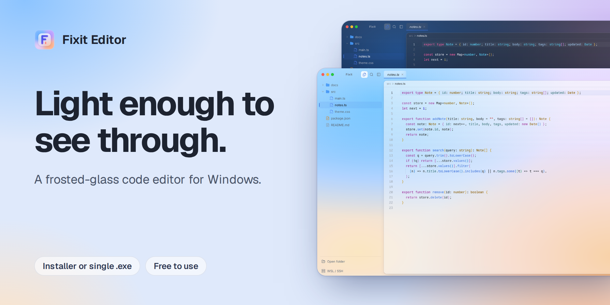
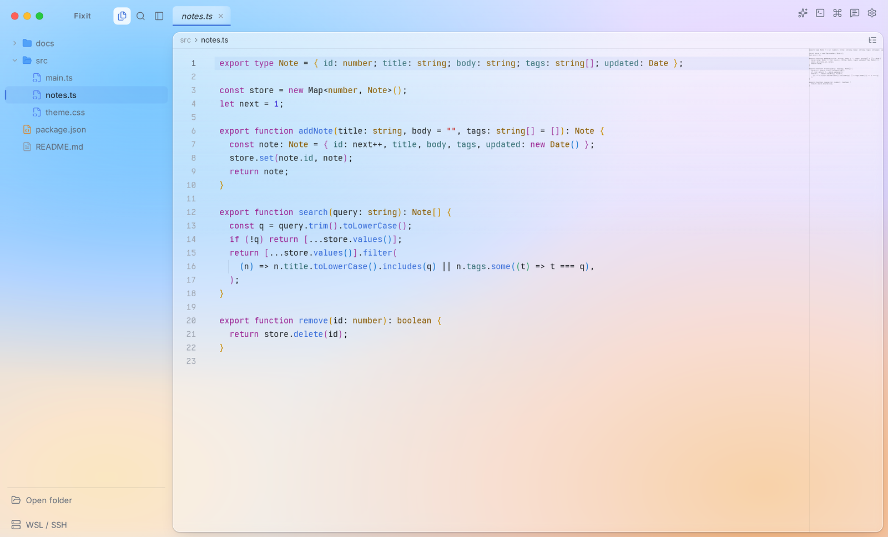
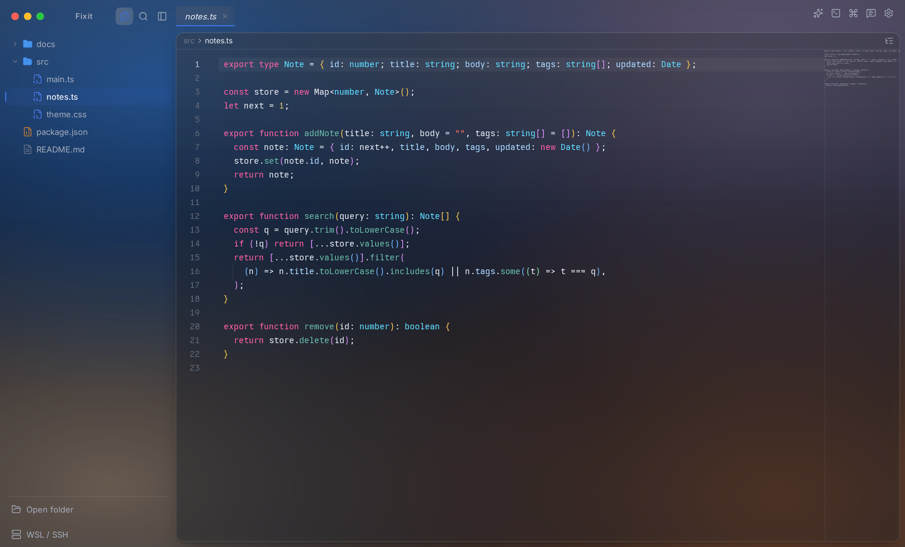
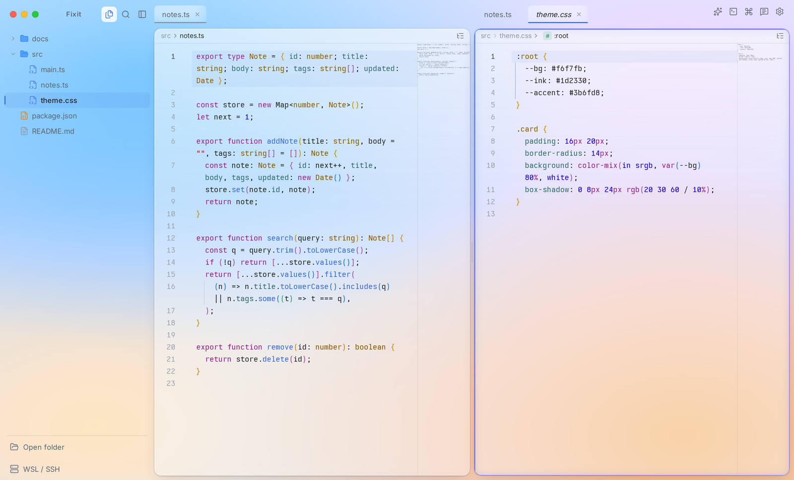
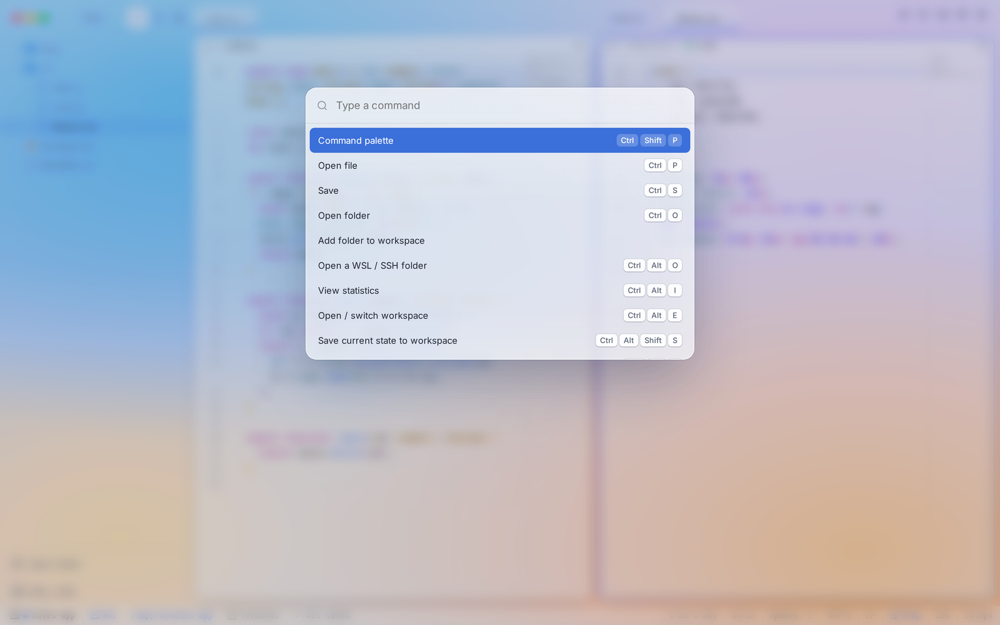

<div align="center">



# Fixit Editor

**A light, frosted-glass code editor for Windows.**


[Website](https://fixit-editor.lapius7.com) · [Docs](https://fixit-editor.lapius7.com/docs) · [Changelog](https://fixit-editor.lapius7.com/changelog) · [License](#license)

**English** · [日本語](README.ja.md) · [한국어](README.ko.md) · [简体中文](README.zh-CN.md) · [Español](README.es.md)

</div>

## Overview

Fixit Editor is a small code editor with a frosted-glass look. It ships for Windows as an installer (`Fixit-Editor-Setup.exe`) and as a single `Fixit-Editor.exe`. It is built on CodeMirror 6 and Tauri, so it starts fast and stays light.

Settings, statistics, and workspaces are stored on your PC. Nothing about your coding leaves it unless you ask an AI a question, log in to Lapount with sync turned on, send feedback, or turn on the optional anonymous reporting. The anonymous launch count is always sent.

<p align="center">
  
  
</p>

## Features

**Editing**

- Open one or more folders and edit with syntax highlighting, completion, and search (CodeMirror 6).
- Split view, full-text search, a command palette, and quick open.
- Open images, PDF, Word, audio, and video. Preview Markdown and HTML next to the source.
- Several terminals, with renamable tabs.
- Run the open file with ▶ (`Ctrl+Alt+R`); the command per extension is editable in Settings.

**Remote and workspaces**

- Open WSL and SSH folders like local ones: browse, edit, save, rename, delete, search, and use a terminal. CRLF files keep their line endings.
- Workspaces save your folders, tabs, split layout, and terminals, and restore them on the next launch.
- Profiles bundle appearance, settings, and shortcuts. Switch between them, tie one to a workspace, or export and import them as files.

**Look and feel**

- Light, dark, or follow the OS. The background is a color mesh you shape by dragging points.
- Over 120 settings with search, a "changed only" filter, per-item reset, and JSON export and import.
- Over 70 shortcuts you can rebind.
- Japanese, English, and Korean.

**AI, only when you ask**

- Ask about the selected code or the open file. Use your own Anthropic or OpenAI API key, or sign in with your Claude subscription through the official `claude` command.
- A consent screen appears before the first request to each provider.

<p align="center">
  
  
</p>

## Privacy

Only the following can leave your PC. File contents, names, and paths are never included.

- **AI requests:** the selected code, the open file, and your message go to the provider you chose.
- **Anonymous usage count:** once a day, a random ID, the app version, the OS family, and the language. There is no setting to turn it off.
- **Feedback:** only when you press Send: your message, its type, an optional contact, the app version, the OS, and the language.
- **Lapount login (optional):** only when you log in, the app fetches your account name and icon and syncs your settings, profiles, and workspaces (names, colors, and folder locations). Open tabs, terminals, AI keys and chats, statistics, and file contents are not synced. You can turn sync off and delete the cloud data. Feedback sent while logged in is linked to your account so you can receive replies.
- **Detailed usage and errors:** daily working time, typed characters, key presses, and saves, and the type, message, and call order of errors. There is no setting to turn this off.

## Build from source

Requirements: pnpm and a Rust toolchain with the `x86_64-pc-windows-gnu` target. The Windows exe is built from WSL or Linux:

```bash
pnpm install
bash scripts/build-win.sh   # writes dist-win/Fixit-Editor.exe
```

## License

All rights reserved. You may use the app for free, but copying, redistributing, or reusing the code is not allowed. See [LICENSE](LICENSE).
