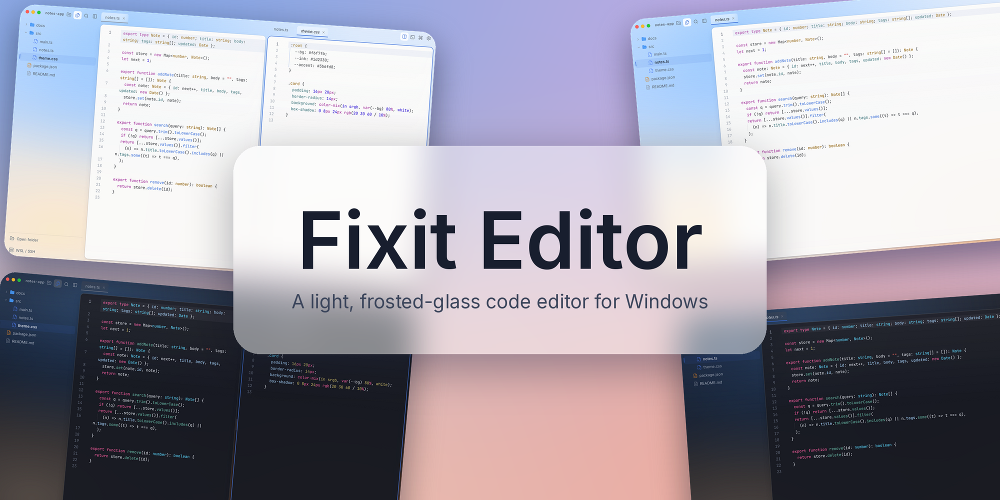
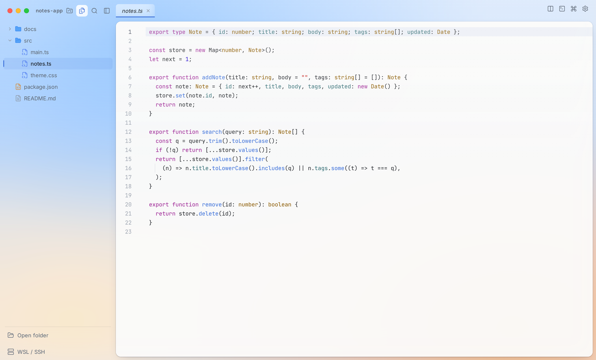
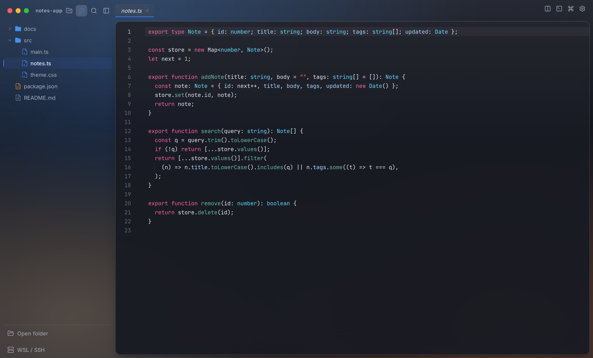
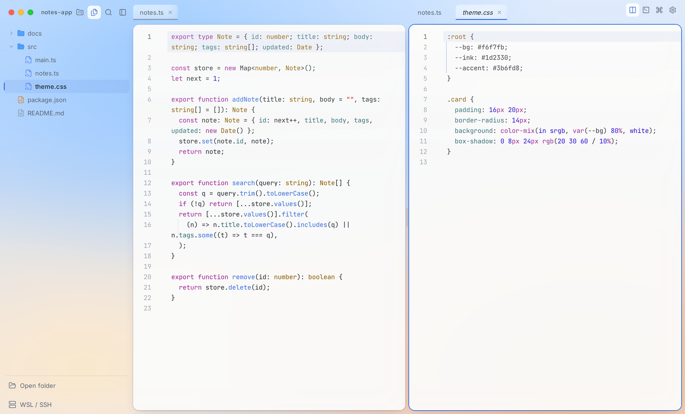
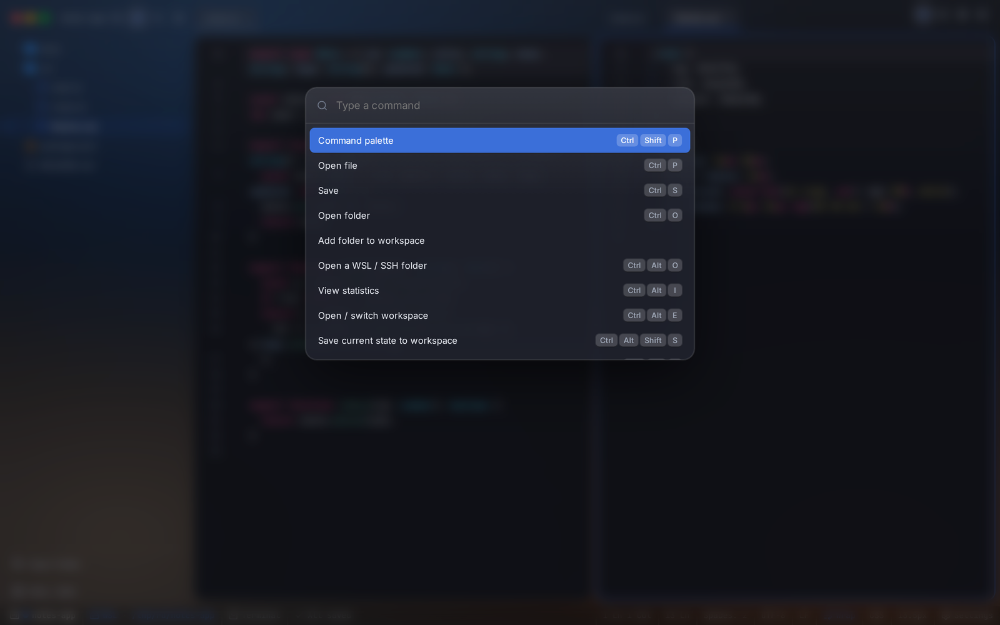

<div align="center">



# Fixit Editor

**轻巧好看、磨砂玻璃风格的 Windows 代码编辑器。**


[官网](https://fixit-editor.lapius7.com) · [文档](https://fixit-editor.lapius7.com/docs) · [更新日志](https://fixit-editor.lapius7.com/changelog) · [许可证](#许可证)

[English](README.md) · [日本語](README.ja.md) · [한국어](README.ko.md) · **简体中文** · [Español](README.es.md)

</div>

## 概述

Fixit Editor 是一款磨砂玻璃风格的小型代码编辑器。无需安装程序，只有一个 `Fixit-Editor.exe` 文件即可运行。它基于 CodeMirror 6 和 Tauri 构建，启动快、占用轻。

设置、统计和工作区都保存在本机。除非你向 AI 提问，或开启匿名使用次数统计，否则你的编码内容不会离开这台电脑。

<p align="center">
  
  
</p>

## 功能

**编辑**

- 可打开一个或多个文件夹，带语法高亮、自动补全和搜索(CodeMirror 6)。
- 支持分屏、全文搜索、命令面板和快速打开。
- 可打开图片、PDF、Word、音频和视频。Markdown 和 HTML 可在源码旁预览。
- 可同时打开多个终端，标签页也能重命名。

**远程与工作区**

- 像打开本机文件夹一样打开 WSL 和 SSH 文件夹，支持浏览、编辑、保存、重命名、删除、搜索和终端。CRLF 文件会保留原有换行符。
- 工作区会一并保存文件夹、标签页、分屏和终端，下次启动时恢复。
- 配置文件把外观、各项设置和快捷键打包在一起。可命名并切换，也可绑定到工作区，还能导出和导入为文件。

**外观与手感**

- 可选浅色、深色，或跟随系统。背景是色彩网格，拖动圆点即可调整。
- 设置超过 120 项，支持搜索、"仅显示已更改"筛选、逐项重置，以及 JSON 导出和导入。
- 快捷键超过 70 个，均可修改。
- 界面支持日语、英语和韩语。

**AI 仅在你提问时使用**

- 可就所选代码或当前文件提问。可使用你自己的 Anthropic / OpenAI API 密钥，也可通过官方 `claude` 命令使用 Claude 订阅登录。
- 首次向各服务商发送内容之前，会显示确认页面。

<p align="center">
  
  
</p>

## 隐私

只有以下两项内容会离开你的电脑，并且只在你操作或在设置中允许时才会发送。编码统计不会外发。

- **AI 提问：** 所选代码、当前文件和你输入的内容，会发送给你选择的服务商。
- **匿名使用次数：** 每天一次，发送随机 ID、应用版本、操作系统类型和语言。可在设置和首次启动设置中关闭。

## 从源码构建

需要 pnpm，以及已安装 `x86_64-pc-windows-gnu` 目标的 Rust。Windows 版 exe 在 WSL 或 Linux 上构建：

```bash
pnpm install
bash scripts/build-win.sh   # 生成 dist-win/Fixit-Editor.exe
```

## 许可证

[MIT](LICENSE)
